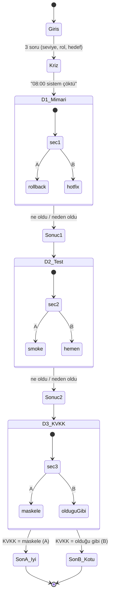

# SE Primer — Spec (spec.md)

> YZM301 · Ödev · 1. Hafta
> Kişiye uyum sağlayan kitap, bu kez yazılım mühendisi için: oyuncu karar verir, uygulama o kararın **teknik sonucunu** gösterir.
> Teslim: `[__ Ekim 2026, 23:59]`

---

## 1. Problem

Yazılım mühendisliği derslerinde kavramlar (rollback, kabul kriteri, KVKK uyumu) soyut kalıyor; öğrenci "doğru cevabı" ezberliyor ama **kararın sonucunu** yaşamıyor.

**SE Primer**, tek bir gerçekçi kriz senaryosunu oynatan, telefonda açılan bir "oynanan kitaptır". Oyuncu üç karar verir; her karardan sonra uygulama **ne olduğunu ve neden olduğunu** gösterir. Bir AI tutor cevabı söylemez, Sokratik soru sorar. Anlatı, oyuncunun seviyesine/rolüne/hedefine göre uyum sağlar.

**Kullanıcı:** SE öğrencisi (yeni → deneyimli).
**Uygulamanın tek işi:** Bir kararın teknik ve yasal sonucunu, oynanarak hissettirmek.

Senaryo: *"08:00, randevu sistemi çöktü. Nöbetçi sensin."* Dün gece yeni sürüm çıktı, 300 hasta bekliyor.

---

## 2. Kapsam dışı (ne yapmayacağız)

- Kullanıcı hesabı, giriş/kayıt, oturum.
- İkinci bölüm / ikinci senaryo (tek sağlık senaryosu).
- Gerçek hasta verisi veya gerçek bir API’ye bağlanma (her şey senaryo içinde sahte veridir).
- Native mobil uygulama (telefon tarayıcısında çalışan web uygulaması yeterli).
- Çok oyunculu / skor tablosu / kalıcı ilerleme.

---

## 3. Kişiselleştirme

Girişte 3 soru sorulur: **seviye, rol, hedef**. Anlatı buna uyar.

| Girdi | Değer | Davranış |
|---|---|---|
| Seviye | Yeni başladım | Her kararda tutor ipucu **otomatik** görünür |
| Seviye | Orta | Tutor ipucu **istek üzerine** (buton) |
| Seviye | Deneyimliyim | Her kararda **60 sn** süre baskısı; süre biterse hızlı/riskli yol otomatik seçilir |
| Rol | Backend / Frontend / Full-stack / Öğrenci | Sonuç metnine role özel bir satır eklenir |
| Hedef | serbest metin | Girişte ve son ekranda yansıtılır |

> "Yeni başladım" diyen oyuncu her kararda ipucu görür; "Deneyimliyim" diyen 60 saniyelik süre baskısı altında karar verir.

---

## 4. Akış şeması — durum makinesi

Her **seçim bir durum geçişi**, her **son bir kabul kriteridir**. Kararlar dallanır ama tek bir akışta birleşir; sonu belirleyen kritik geçiş KVKK kararıdır (Sommerville 2016, Böl. 5).



**Durum çubuğu (kalıcı durum):** saat `08:00 → 08:25` ilerler; sistem durumu `ÇÖKTÜ → RİSKLİ → AYAKTA` değişir. Durum sadece metinde değil, renkli rozette de görünür.

Kararlar ve geçişler:

| Karar | A | B | A sonucu (saat/durum) | B sonucu (saat/durum) |
|---|---|---|---|---|
| 1 · Mimari | Rollback | Hotfix | 08:10 · Riskli (şema uyumsuz) | 08:12 · Riskli (geri alınabilir yama) |
| 2 · Test | Smoke test | Hemen yayın | 08:18 · Ayakta (kanıtlı) | 08:16 · Riskli (çakışma) |
| 3 · KVKK | Maskele | Olduğu gibi | 08:25 · Ayakta → **Son A** | 08:22 · Riskli → **Son B** |

---

## 5. Kabul kriterleri (5 örnek)

Gherkin biçiminde; her biri Cypress ile doğrulanır (bkz. `cypress/e2e/primer.cy.js`).

### KÖ-1 · Giriş kişiselleştirmeyi uygular
```gherkin
Given uygulama ilk açıldığında giriş ekranı görünür
When seviye "Yeni başladım", rol "Backend", hedef "sakin kalmak" seçip "Nöbete başla" denir
Then kriz sahnesi açılır ("08:00 — Randevu sistemi çöktü")
And ilk kararda tutor ipucu otomatik görünür
```

### KÖ-2 · Her karardan sonra "ne oldu / neden oldu" gösterilir
```gherkin
Given oyuncu Karar 1’de bir seçenek seçtiğinde
When seçim yapılır
Then "ne oldu" ve "neden" satırları görünür
And durum çubuğundaki saat ve sistem durumu güncellenir
```

### KÖ-3 · İyi son (veri güvende)
```gherkin
Given oyuncu üç kararı da verir
When Karar 3’te "Maskele (A)" seçilir
Then "Son A · İyi" ekranı görünür (data-ending="good")
And "Kişisel veri KVKK’ya uygun korundu" kriteri ✓ işaretlenir
```

### KÖ-4 · Kötü son (KVKK ihlali)
```gherkin
Given oyuncu üç kararı da verir
When Karar 3’te "Olduğu gibi at (B)" seçilir
Then "Son B · Kötü" ekranı görünür (data-ending="bad")
And "KVKK ihlali" uyarısı ve ✕ işareti gösterilir
```

### KÖ-5 · AI tutor cevabı vermez, sorar
```gherkin
Given tutor paneli açık olduğunda
When oyuncu bir düşünme seçeneğine tıklar
Then tutor başka bir soruyla yanıt verir (takip sorusu)
And hiçbir yerde "doğru cevap A/B’dir" denmez
```

> **Deneyimli varyantı (ek):** Seviye "Deneyimliyim" seçilirse her kararda 60 sn sayaç görünür; süre dolarsa hızlı/riskli seçenek (B) otomatik işlenir.
